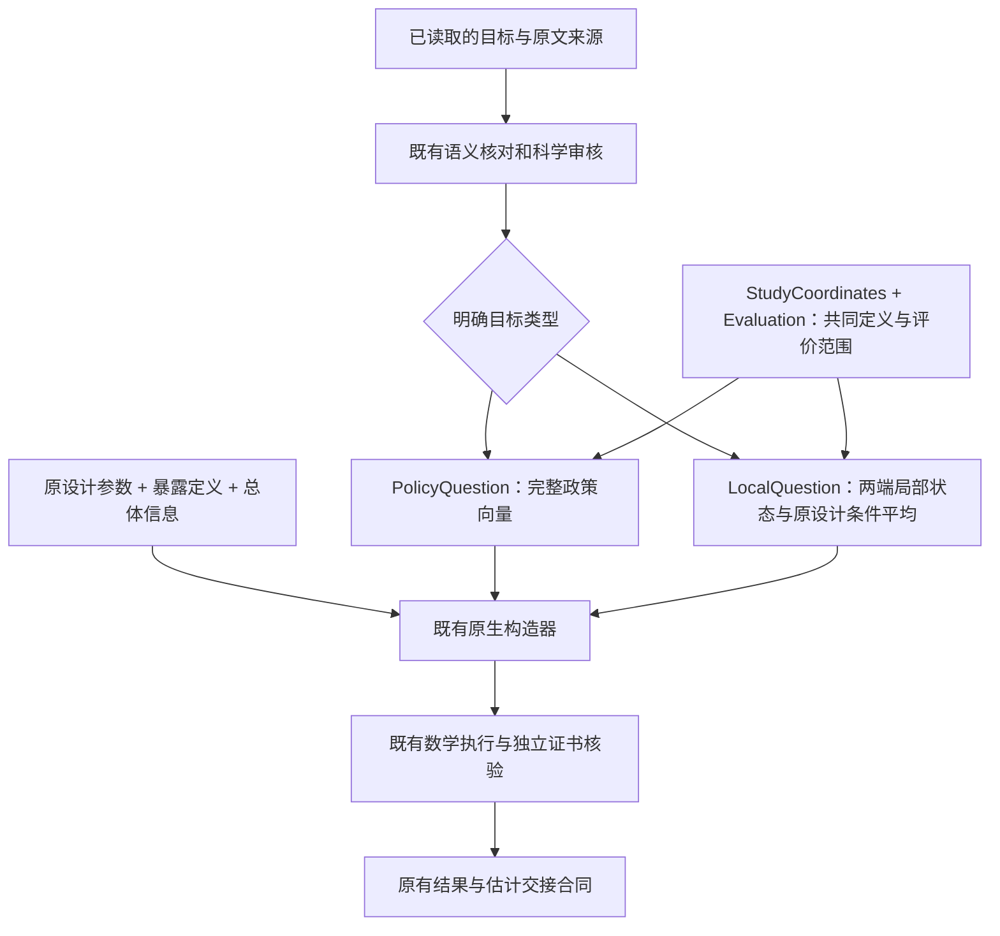

# 局部效应的内部属性与执行适配

更新日期：2026-11-24。本阶段处理随机化网络中按原设计条件平均的两状态比较，对应现有 R1a 效应路线。保留读取、来源审核、科学审核及数学证明；没有改变 LLM 合同或增加可支持的组合。

执行层已进一步整理：单个局部均值与局部比较共同从 `local_methods` 取得实际求解／验证函数，`local_execution` 复用原生调用和输入／证据绑定检查。两状态的类型化目标仍由本文的 `LocalQuestion` 构造；单均值仍用自己的单端原生规格，不套用两端对象。具名效应与反向线性证书的区别继续保留，详见[执行职责与迁移边界](EXECUTION_ARCHITECTURE_ZH.md)。

## 与完整政策的区别

“本人启用、邻居中超过一半启用”只指定一个局部状态，可能对应很多份完整安排。其他对象的处理不能由程序填成全开或全关，而是按原分配设计在该状态下的条件分布平均。

完整政策指定每个对象的处理，因此用 `FixedPolicy`；局部状态指定本人处理和同伴暴露，因此用 `LocalState`。两者共用名单、结果、背景和评价权重的定义，不共用干预端点类型。

这是职责图。具体入口仍按原顺序完成审核与构造；建立值对象本身不代表已获批准。

## 一个值由一个对象负责

| 对象 | 负责的内容 | 仍须另行检查 |
|---|---|---|
| `StudyCoordinates` | 完整名单顺序、处理定义、结果定义及值域、共同背景 | 来源、网络关系、科学采用态度 |
| `Evaluation` | 评价名单和按完整名单对齐的精确权重 | 人群是否预先确定；不能把零权单位从完整网络删除 |
| `LocalState` | 本人的 0/1 状态、同伴暴露坐标 | 暴露映射是否合法、在原设计中有无支持 |
| `LocalQuestion` | 两端、第一端减第二端、其余安排按原设计条件平均 | 不确定的平均方式仍阻断，不能推断成固定完整安排 |
| 现有 D/E 适配与审核 | 历史分配参数、暴露定义、各自证据 | 不因目标对象完整而批准随机化或暴露充分性 |

直接效应、同伴效应、局部总效应由“哪一项状态改变”描述。原读取名称与坐标不一致时仍要求复核。这个描述不选择定理，也不保证可识别。

暴露可以是人数整数，也可以是原加权／分组合同采用的精确字符串。字符串先原样保留，其数学含义与支持由原生合同检查，不把任意字符串当作已支持映射。

## 已接入的路径

| 路径 | 属性实际用于什么 |
|---|---|
| 经典随机化局部效应 | 构造审核目标坐标、原生单臂种子和效应查询；直接、同伴及局部总效应保留原相减方向 |
| 反向直接／局部总效应 | 使用既有线性项接口，不交换两端后冒充同一问题 |
| 紧凑读取 `local_difference` | 构造共享研究、局部两端及权重；支持检查、计算、证书与重放保持原实现 |
| 默认直答核验及上传关系文件的 `original_local` | 构造确定的局部坐标，再交给原事件查询与证明链；原始材料和科学声明不被覆盖 |

`local_difference` 和 `original_local` 的既有合同已明确采用原设计条件平均；适配器只是展开该含义。是否忠于业务原文仍由原来源核对负责，不能靠构造器猜测自然语言。

默认事件合同没有单独登记结果值域，所以此处 `outcome_domain=None`。不得擅自声明二元或连续结果；需要值域的原生研究构造器会拒绝缺项。旧合并背景字符串也不被擅自拆成时期和科学条件。

观察性局部效应已在后续阶段接入独立的 [ObservationalEffectQuestion](RESEARCH_SPEC_OBSERVATIONAL_EXECUTION_ZH.md)，没有套用随机化的 `LocalQuestion`。单状态查询、有限随机政策混合、DAG/IV 和上传的原生规格保留专用合同，理由见[入口清单](RESEARCH_SPEC_ENTRY_STATUS_ZH.md)。数学验证器仍按原协议独立重建目标，不跟着生产适配器共同改写。

## 维护位置

- [research_spec_coordinates.py](../cfm_id/research_spec_coordinates.py)：名单、定义和评价权重的唯一公共实现；原 `research_spec_policy` 导入路径保留兼容引用。
- [research_spec_local.py](../cfm_id/research_spec_local.py)：局部目标值对象，不保存旧 JSON，不解释自然语言，不批准科学条件。
- [research_spec_local_adapters.py](../cfm_id/research_spec_local_adapters.py)：已知旧合同到属性，再从属性构造原生查询或事件坐标。
- [network_effect_dispatch.py](../cfm_id/network_effect_dispatch.py)、[network_design_adapter.py](../cfm_id/network_design_adapter.py)：保留原方法分派、来源和审核门槛。共用的单状态构造入口仍可独立使用。
- [compact_network.py](../cfm_id/compact_network.py)、[network_query_binding.py](../cfm_id/network_query_binding.py)：接入紧凑读取及默认事件查询，避免只迁移经典入口。

## 验收边界

本地 `reviews/local-effect-model-migration-20261124/` 保存修改前适配器与对照脚本。对同一输入分别运行新旧构造路径，31 个场景的完整返回一致，包括目标、原审核绑定、执行结果、证书和默认上传路径的交接包／接收校验。

其中包含 D1–D8 的八个代表性设计／暴露配对、加权／分组暴露、反向比较、子人群和单对象。缺其余安排、仅有有限样本、分配后才决定评价名单等情况保持原阻断；孤立点的零支持也不变。未穷举所有 D×E 组合。

这证明内部构造兼容，不证明 LLM 读题更准。本轮没有调用项目 API，也没有操作真实浏览器；网页部分使用默认入口后端与原上传材料测试。后续观察性阶段已分别处理实际采用律／共同分层／节点调整职责，详见[观察性执行说明](RESEARCH_SPEC_OBSERVATIONAL_EXECUTION_ZH.md)。
